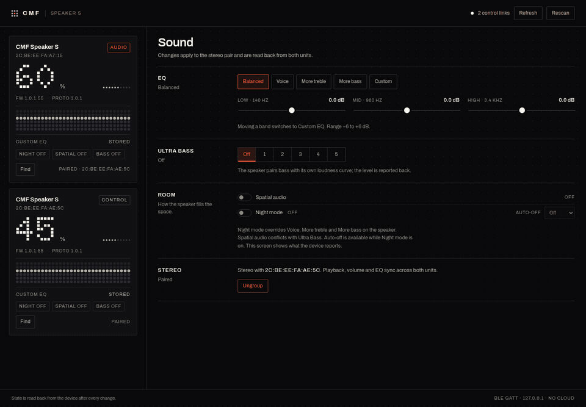

# CMF Speaker S — Linux panel



*Demo data; Bluetooth addresses changed.*

Unofficial Linux control panel for **CMF Speaker S (model E494)** — a **Nothing X alternative for Linux**. Control EQ, Ultra Bass, spatial audio, night mode, battery, find, and stereo pairing over BLE GATT. Local web UI + CLI. No phone, no account, no cloud.

## Start the web UI

Debian/Ubuntu, once:

```bash
sudo apt install python3-dbus python3-gi bluez
```

Then:

```bash
python3 -m cmf.ui
```

Opens `http://127.0.0.1:8747/`. Keep the terminal open; Ctrl+C stops the server and releases the BLE link.

## Use the UI

1. Power on one or two units. The UI scans, opens the BLE control link, and reads their state.
2. Each card shows `AUDIO` (receives this laptop's A2DP) or `CONTROL` (BLE control only). No `AUDIO` badge = connect audio in Bluetooth settings first.
3. Change sound in the right panel: EQ presets or Custom bands, Ultra Bass Off/1–5, Spatial, Night + auto-off. Every change is read back; cards show the device state.
4. `Refresh` rereads state without reconnecting. `Rescan` reconnects after power or audio changes.
5. With two units paired, sound applies to the pair. `Pair stereo` arms on first click (`Confirm pair`) and sends on the second; `Ungroup` returns both to single.
6. `Find` on a card plays the locating sound on that unit.

The speaker enforces interlocks silently; the UI always shows the read-back result.

## CLI

```bash
python3 -m cmf scan
python3 -m cmf status
python3 -m cmf eq bass
python3 -m cmf custom-eq 3 0 -2
python3 -m cmf bass 3
python3 -m cmf spatial on
python3 -m cmf night on --minutes 300
python3 -m cmf find
python3 -m cmf pair --master AA:BB:CC:DD:EE:01 --slave AA:BB:CC:DD:EE:02
python3 -m cmf ungroup --mac AA:BB:CC:DD:EE:01
```

Use `--mac` to target one unit when two are visible. `python3 -m cmf --help` lists all commands. MACs above are examples; run `scan` for yours.

## Stereo notes

- Pair while this laptop's A2DP audio is already connected to the master.
- Both units must be identical and on the same firmware; the second should be idle.
- While paired, sound applies to the pair; per-unit target is hidden and a slave-only write is redirected to the master. Find stays per-unit.
- After pairing both units stop advertising; ungroup from the master.

## Requirements

| Component | Version / package |
|---|---|
| Linux | BlueZ 5.87+ (tested on Ubuntu 26.10) |
| Python | 3.11+ |
| D-Bus bindings | `python3-dbus` |
| GLib/GObject bindings | `python3-gi` (PyGObject) |
| Audio | PipeWire or another A2DP stack, for audio/stereo routing |
| Fonts | bundled: Archivo and Doto, SIL OFL 1.1 |

No pip dependencies.

## Tests

```bash
python3 -m unittest discover
```

27 tests: framing/CRC, payload codecs, stereo frames, advertisement parsing, UI validation, stereo sync. No hardware needed.

## Optional packaging

```bash
python3 -m pip install --user -e .
cmf --help
cmf-ui
```

If pip refuses with a PEP 668 externally-managed error, use a virtualenv or run from the checkout.

## Docs

- [Protocol notes](docs/PROTOCOL.md) — frames, commands, stereo sequence, firmware quirks.
- [Design system](docs/DESIGN.md) — palette, type, components.
- [Extracted constants](docs/protocol-constants-3.10.3.txt) — command ids from Nothing X 3.10.3.

## Safety

- Local only; the server binds `127.0.0.1`.
- The control channel is unauthenticated; do not expose it.
- Never write OTA (`e49a25f8…`, `0x6666`) or Fast Pair (`0000fe2c…`).
- The device enforces interlocks silently; this app shows read-back state.
- LE addresses rotate; units are identified by the classic MAC in the `0x0CCB` advertisement.

## License

MIT © 2026 haosb — see [LICENSE](LICENSE). Bundled Archivo/Doto fonts are SIL OFL 1.1 — see `cmf/ui/fonts/*-OFL.txt`.

Nothing X and CMF are trademarks of Nothing Technology. This project is not affiliated with or endorsed by them. The protocol notes document interoperability observations from a legally owned device; no proprietary code or APK assets are included.
